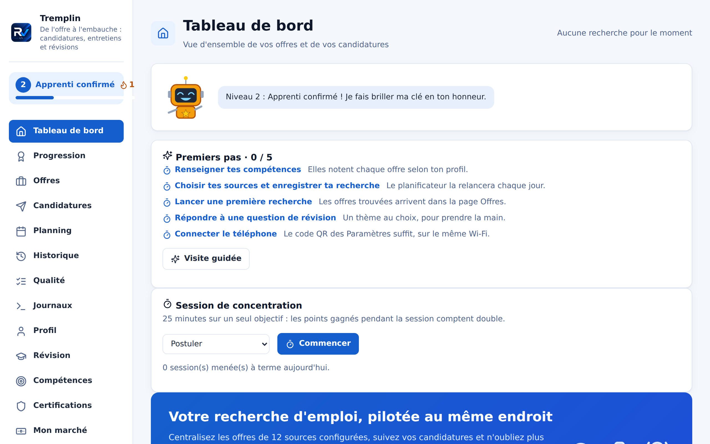
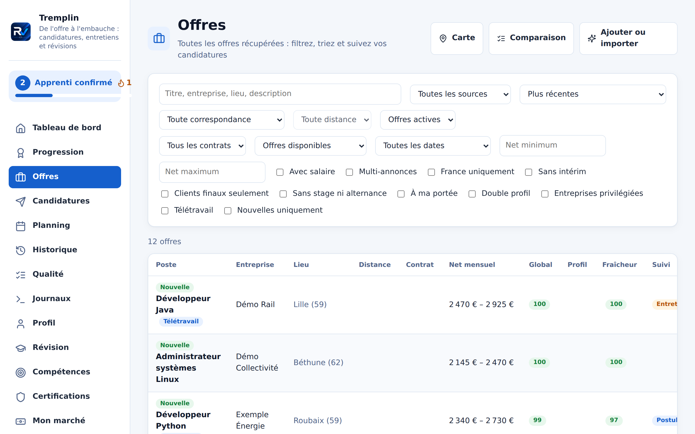
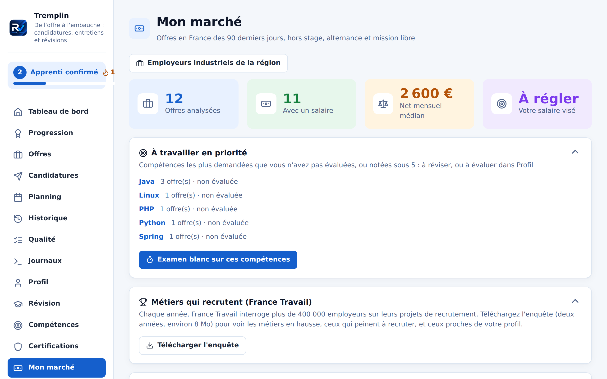

# Tremplin

[](https://github.com/Remiverhaeghe/tremplin/actions/workflows/ci.yml)

Mon outil de recherche d'emploi, de l'offre à l'embauche. Il rassemble les offres de
21 sources par leurs API officielles, suit les candidatures et les relances, prépare les
entretiens et fait réviser les compétences techniques demandées. Le tout tourne sur mon
PC, sur mon NAS et sur mon téléphone, sans service payant.







Le projet s'appelait `scraper-data-python` : il a commencé comme un scraper de pages
web, avant que toutes les sources passent par des API.

## Ce qu'il fait

- **Offres** : France Travail, La bonne alternance, Adzuna, Jooble et 17 autres sources,
  dédoublonnées, géolocalisées sur une carte et filtrées selon mon profil.
- **Candidatures** : suivi par statut avec historique, relances, pièces jointes, agenda
  des entretiens à s'abonner depuis le téléphone.
- **Préparation** : simulation d'entretien chronométrée, fiche de préparation par offre,
  grille d'auto-évaluation des compétences.
- **Révision** : questions par thème, défis de programmation, bacs à sable Git et SQL,
  pannes à résoudre, simulateur d'automate.
- **Trois accès** : application de bureau (PySide6), tableau de bord web sur le NAS
  (FastAPI, HTMX), application Android de révision (Flutter) qui se synchronise avec le PC.

## Qualité

95 % de couverture exigée, pylint à 9,8 au moins, analyse de sécurité bandit, tests
sous Linux et Windows, tests de bout en bout du web dans Chromium, synchronisation
téléphone-serveur testée en CI, image Docker durcie vérifiée à chaque push.

## Stack technique

- **Langage :** Python 3
- **Requêtes HTTP :** requests
- **Nettoyage du HTML des descriptions :** beautifulsoup4
- **Lecture des CV au format PDF :** pypdf
- **Analyse et structure des données :** pandas
- **Tests :** pytest, Playwright (navigateur, tests de bout en bout du web)
- **Stockage :** SQLite
- **Interface graphique :** PySide6 (Qt)
- **Tableau de bord web :** FastAPI, Jinja2, HTMX

---

## Lancement

```bash
pip install -r requirements.txt
cp .env.example .env              # puis renseigner les clés des sources utilisées
python -m web.password            # empreinte du mot de passe du tableau de bord web

python main.py                    # interface graphique
python -m cli.main --help         # ligne de commande
python -m web                     # tableau de bord sur http://127.0.0.1:8000
python -m scheduler               # recherche planifiée et notifications (--once : une vérification)
python -m tools.windows_startup   # lance web et planificateur à l'ouverture de session (--remove : retire)

pip install -r requirements-translation.txt   # facultatif, environ 1 Go : traduction hors ligne
python -m job.translation                     # télécharge les modèles allemand et anglais vers français

python -m playwright install chromium   # une fois, pour les tests de bout en bout du web
pytest                            # tous les tests ; ceux du navigateur sont ignorés sans Chromium
pytest -n auto                    # les mêmes, en parallèle sur tous les cœurs
python -m tools.web_captures captures   # captures du tableau de bord sur des données fictives
```

### Où sont les données

Le projet ne contient que le code. Les données sont dans `Documents\JobBoard`
(modifiable par `JOBBOARD_DATA_DIR` dans `.env`) :

```text
Documents/JobBoard/
├── scraper.db        # Base : offres, candidatures, profil, réglages
├── backups/          # Sauvegardes automatiques et avant opération risquée
├── attachments/      # Pièces jointes des candidatures
├── logs/             # Journaux, un fichier par jour
├── exports/          # Proposé pour enregistrer un export, un CV, une fiche
├── imports/          # Proposé pour ouvrir un fichier à importer
├── bmo/              # Enquêtes Besoins en Main-d'Œuvre résumées
├── packs/            # Lots de révision validés
├── tls/              # Certificat HTTPS du tableau de bord
└── argos/            # Modèles de traduction hors ligne (facultatifs)
```

## Documentation

| Document | Contenu |
|---|---|
| [Fonctionnalités](docs/fonctionnalites.md) | Sources d'emploi, bureau, web, candidatures, évolutions |
| [Architecture](docs/architecture.md) | Organisation du code, qualité, arborescence |
| [Sécurité](docs/securite.md) | Mesures en place ; signalement dans [SECURITY.md](SECURITY.md) |
| [Docker et NAS](docs/docker-nas.md) | Conteneurs du web et du planificateur |
| [Téléphone](docs/mobile.md) | Accès à distance, API de l'application mobile |
| [Révision](docs/revision.md) | Révision, défis, tests et simulations |
| [Questions avec ChatGPT](docs/consignes-qcm-chatgpt.md) | Génération et import des lots de questions |
| [Application mobile](mobile/README.md) | Installation et compilation |
| [Historique](CHANGELOG.md) | Évolutions par version |

## Licence

Ce projet est publié sous licence [PolyForm Strict 1.0.0](LICENSE) : le code peut être consulté et utilisé tel quel à des fins non commerciales, mais ni modifié, ni redistribué.

Les icônes de `assets/icons/` proviennent de [Lucide](https://lucide.dev) et restent sous leur licence [ISC](assets/icons/LICENSE).
La carte des offres utilise [Leaflet](https://leafletjs.com), sous licence [BSD](web/static/leaflet/LICENSE), et les fonds de carte d'[OpenStreetMap](https://www.openstreetmap.org/copyright).
